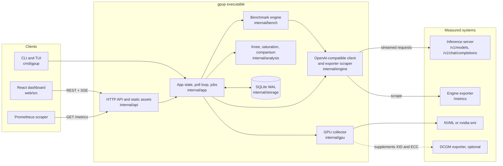
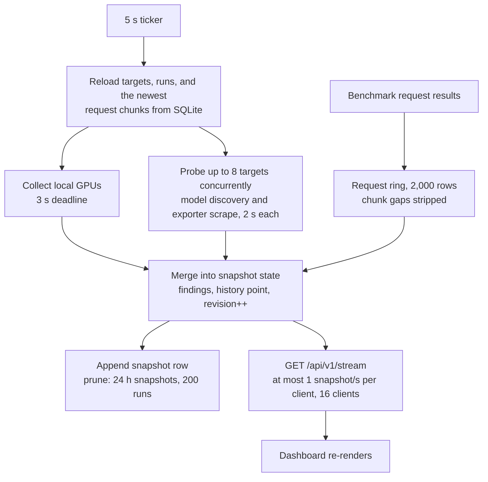
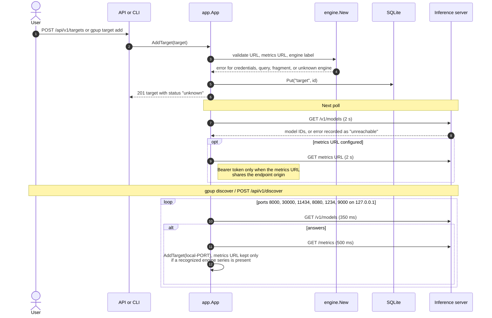
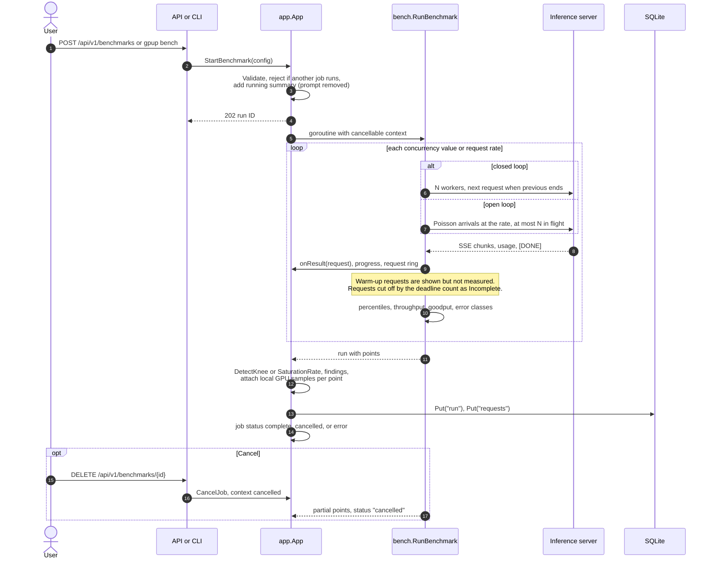
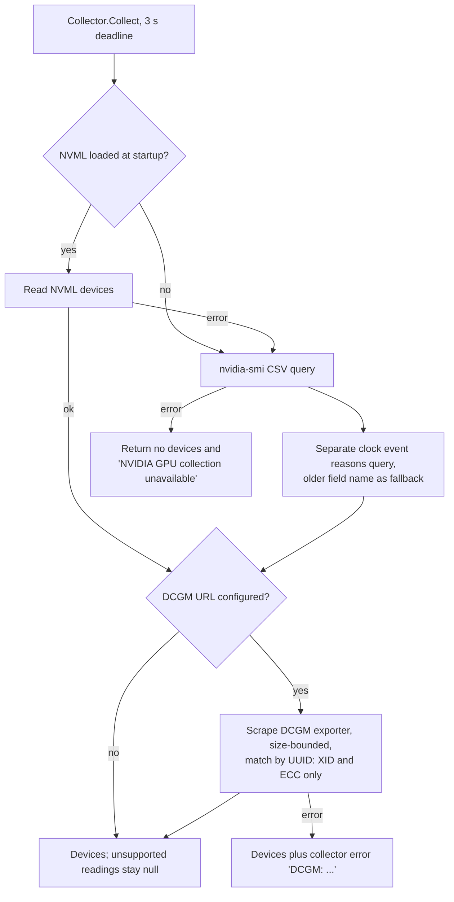
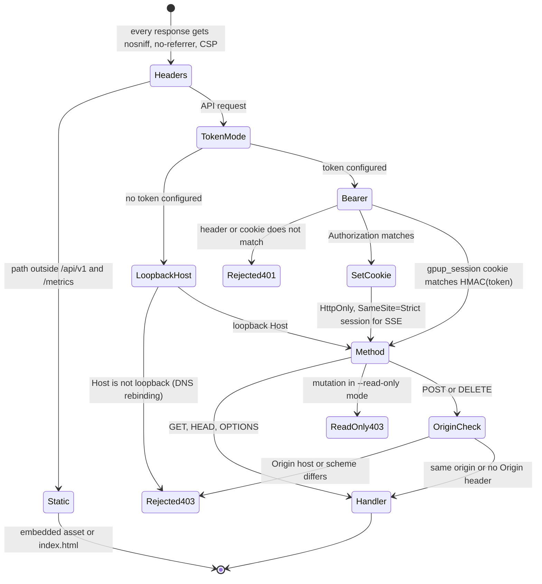
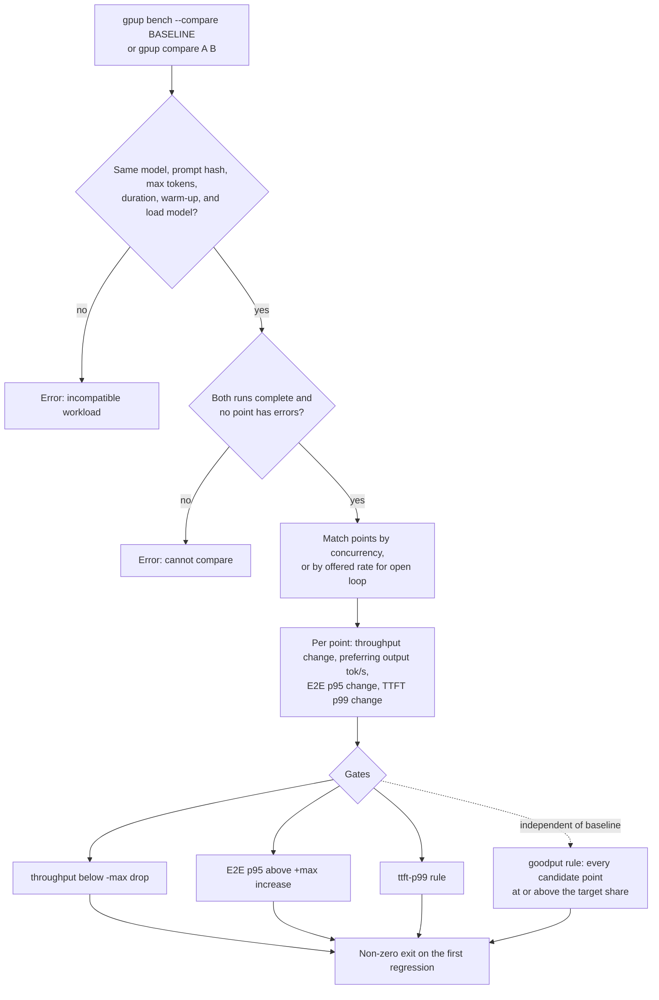
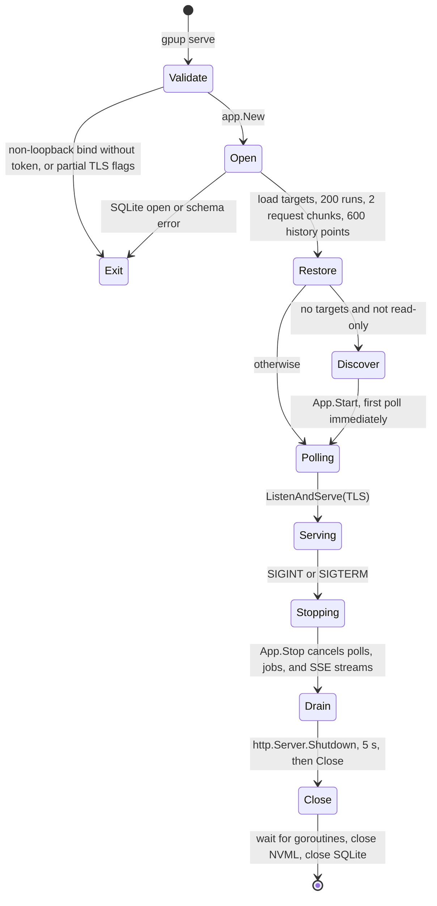

# Architecture

GPUP is one Go executable. The same binary runs CLI commands, the terminal dashboard (`gpup top`), and the HTTP server that embeds the React dashboard. Every process opens the same SQLite workspace, so a CLI benchmark run while `gpup serve` is running appears in the dashboard after the next poll.

The diagrams below follow the code paths in `cmd/gpup`, `internal/*`, and `web/src`. Package names are given so each box can be traced to its source.

## System overview

## Live data flow

`App.Poll` runs once at startup and then every 5 seconds. Each change to state increments a revision counter; the SSE handler checks it once per second and sends a full snapshot only when it changed, with a heartbeat comment every 15 seconds otherwise.

## Target registration and discovery

Every outbound connection from `internal/engine` refuses link-local and unspecified addresses after DNS resolution, so a target cannot reach instance-metadata services such as `169.254.169.254`.

## Benchmark execution

## GPU telemetry and fallback

GPU readings describe the host running GPUP. They are never attributed to a remote target.

## API authentication and browser communication

Binding to a non-loopback address requires `GPUP_API_TOKEN`. The dashboard keeps a token entered by the user in `sessionStorage`, sends it as a bearer header, and the first authenticated response sets the session cookie that `EventSource` uses for `/api/v1/stream`.

## Comparison and regression gates

## Process lifecycle

CLI commands use the same `app.New` and `App.Close` path without the HTTP server. `gpup bench` starts the poll loop so GPU samples can be attached to points, and cancels its job on interrupt.
